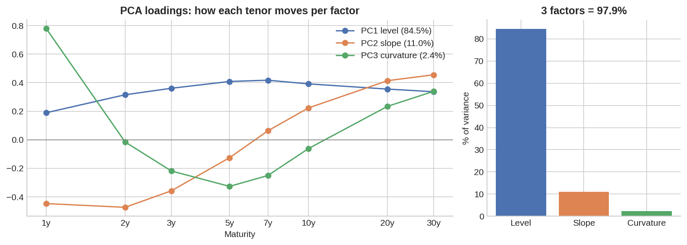
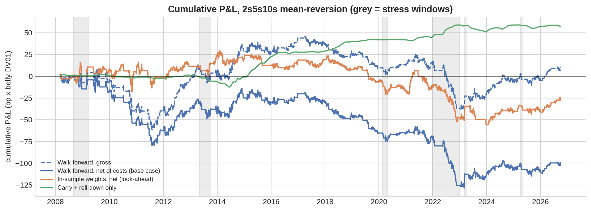
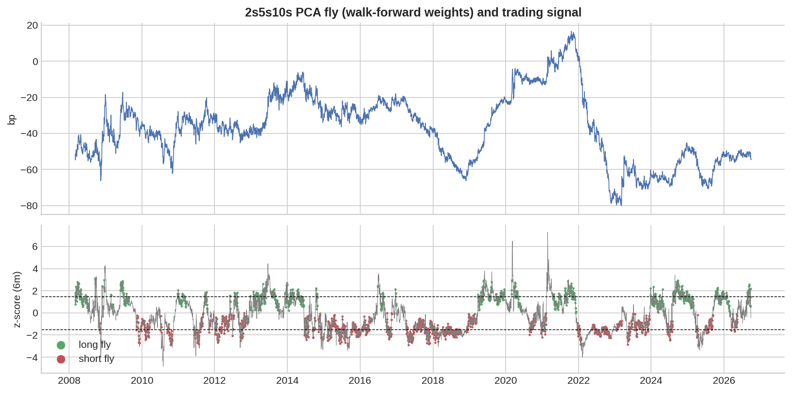
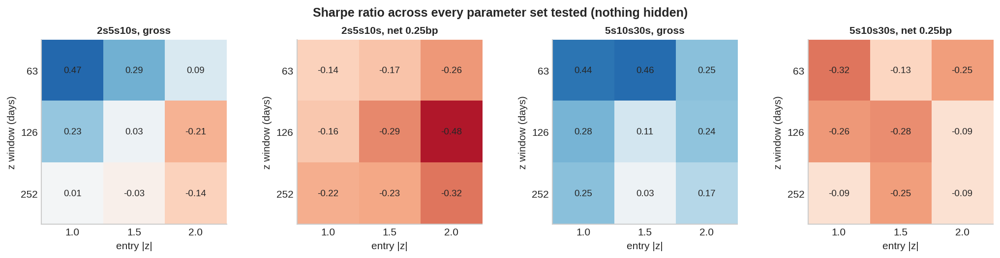

# Is the US Treasury butterfly tradeable? A PCA relative-value study

**Kristin Zamfirov** · BSc Economics, Finance & Data Science, Imperial College London · October 2026

## Question

Treasury desks and macro funds trade *butterflies* — the belly of the curve against the two wings — because, once level and slope are hedged out, what remains looks like a mean-reverting relative-value spread. This project asks a narrow, testable question:

> After hedging level and slope with principal component analysis, does the 2s5s10s butterfly mean-revert enough to trade **out of sample, after transaction costs**?

## Short answer

**No.** The PCA hedge works, but the mean-reversion edge does not survive costs.

| Finding | Evidence |
|---|---|
| Three factors explain almost all curve moves | Level 84.5%, slope 11.0%, curvature 2.4% of daily variance (97.9% total), 2006–2026 |
| The PCA hedge does its job | Level + slope explain **4%** of daily PCA-fly moves vs **26%** for a standard 50/50 DV01 fly |
| The mean-reversion edge is smaller than trading costs | Break-even cost of **0.02bp per leg** vs a conservative 0.25bp assumption; base case Sharpe **−0.29** net |
| The result does not depend on parameter choice | **0 of 18** parameter sets profitable after costs (median Sharpe +0.20 gross, −0.24 net), on both 2s5s10s and 5s10s30s |
| Losses come from regimes, not noise | 2022 hiking cycle = **−57bp of the −100bp** total loss; half-life of the fly is **32 days within a year** but **443 days** across the full sample — the "mean" itself moves |
| The data point the other way | A high fly z-score predicts the fly moving *further* away over 20–60 days (correlation +0.09 at 20d, +0.21 at 60d) — continuation, not reversion |
| Look-ahead flatters results | Using full-sample (future) PCA weights improves P&L by 72bp vs honest walk-forward weights |

## Data

Daily US Treasury constant-maturity yields (3M, 1, 2, 3, 5, 7, 10, 20, 30 years) from FRED, 9 Feb 2006 – 29 Sep 2026 (5,164 complete curves). The start date is when the 30-year was reintroduced. The 3-month bill proxies the repo (financing) rate.

## Method

**1. PCA on daily yield changes (bp), covariance matrix.** Following Litterman & Scheinkman (1991). Covariance rather than correlation, because every tenor is in the same unit and the size of the move matters.



**2. PCA-neutral butterfly.** fly = y5 − a·y2 − b·y10, in DV01 (risk) terms. a and b are solved so the fly has zero loading on PC1 and PC2. Typical weights are a ≈ 0.5, b ≈ 0.6, i.e. ~1.15 DV01 of wings per 1 DV01 of belly. The belly moves more than either wing on a level shift (loading 0.41 vs 0.32 and 0.39), so the textbook 50/50 fly is under-hedged against level. That is why its level beta is positive in the hedge test.

**3. Walk-forward, no look-ahead.** Each month, the PCA is re-estimated on the previous two years only. The z-score on day *t* uses closes up to *t*. A position decided at *t* earns the move from *t* to *t+1*.

**4. Trading rule, fixed before testing.**

- **Entry:** when the fly is |z| ≥ 1.5 from its 6-month mean. The trade buys the cheap side: long the belly when z is high.
- **Exit:** at z = 0, a stop at |z| ≥ 3, or after 60 days.
- **Re-entry:** blocked after a stop until the signal resets.

**5. P&L** = −Δfly + carry + roll-down − costs, in bp per unit of belly DV01.

- **Carry:** (yield − repo) / duration.
- **Roll-down:** the local slope of the curve.
- **Costs:** 0.25bp per leg per side as the base case. This is deliberately conservative. The New York Fed estimates the effective customer spread on the on-the-run 2-year at 0.66bp of price, roughly 0.35bp of yield, i.e. ~0.17bp each side.

## Results

| Out-of-sample, Mar 2008 – Sep 2026 | PCA walk-forward (base) | PCA in-sample (look-ahead) | 50/50 DV01 fly |
|---|---|---|---|
| Total P&L (bp) | −99.9 | −27.6 | −18.3 |
| Sharpe | −0.29 | −0.09 | −0.06 |
| Max drawdown (bp) | −130.7 | −85.2 | −56.8 |
| Trades / hit rate | 94 / 51% | 84 / 55% | 78 / 62% |
| Price P&L / carry + roll / costs (bp) | −46.9 / +56.9 / −109.9 | +20.3 / +43.0 / −90.8 | +51.5 / +8.7 / −78.5 |

The 50/50 fly "loses less", but its price P&L comes from unhedged level and slope exposure (26% of its variance), not from relative value. That makes it a different, riskier trade, not a better one.



**Cost sensitivity (Sharpe):** 0.03 at zero cost, −0.10 at 0.1bp, −0.29 at 0.25bp, −0.61 at 0.5bp.

**Stress windows (net bp):**

| Window | Net P&L (bp) |
|---|---|
| GFC | −2.6 |
| Taper tantrum | −13.6 |
| COVID dash for cash | −7.1 |
| 2022 hiking cycle | −56.5 |
| SVB, Mar 2023 | +15.2 |
| Tariff shock, Apr 2025 | −5.4 |



The fly fell roughly 95bp between late 2021 and early 2023. The strategy kept fading the move. This is consistent with the belly pricing the eventual cutting cycle while the 2-year priced the hikes: a macro view moving the curvature, not a temporary dislocation.



## Interpretation

1. **Hedging is not the same as stationarity.** PCA removes level and slope risk, but the curvature that remains is driven by the expected policy path. It mean-reverts within regimes and trends between them.
2. **The edge shows up only at short horizons, and is smaller than the bid-offer.** Some of it is probably interpolation noise in the fitted constant-maturity curve, which no one can trade.
3. **Carry + roll-down was the only consistently positive P&L source** (+57bp). This is why practitioners treat carry as part of the signal, not just an accrual.
4. **Most backtests are flattered by small choices.** Look-ahead in one input (the hedge weights) was worth 72bp here.

## Limitations

- **Interpolated, not tradeable, yields.** Constant-maturity yields are a fitted par curve, not tradeable bonds. A real implementation uses on-the-run cash bonds (with on/off-the-run effects) or futures (with cheapest-to-deliver and basis risk).
- **Simplified risk and financing.** Durations are par-bond approximations with no convexity. Weights are frozen at entry. Repo is proxied by the 3-month bill, which ignores specialness.
- **Flat costs.** Costs are constant, but real spreads widen in stress — which would make the stress-window results worse.
- **Overlapping horizons.** The 20–60 day predictive correlations use overlapping windows (sampled every 5 days), so their statistical significance is overstated.
- **A regime filter was tried and did not help.** The filter (only trade when the in-window half-life < 63 days, after Avellaneda & Lee, 2010) barely changed anything (93 vs 94 trades). It is left in the code, off by default.
- **US only.** Gilts and other markets are not covered.

## Next step

The continuation result was *found* in this sample, so it cannot be *tested* on it without data-snooping. The honest test is a fresh market: run the same pipeline on gilts (Bank of England curve data) or Bunds, and test a trend-following rule on the fly there.

## Run it

```
pip install -r requirements.txt
python run_all.py        # downloads FRED data, writes figures/ and results/
```

Code layout:

| File | Contents |
|---|---|
| `src/data.py` | Data download and loading |
| `src/pca.py` | Factor model |
| `src/fly.py` | Butterfly weights, carry and roll-down |
| `src/backtest.py` | Walk-forward engine and metrics |

## References

- Litterman, R. & Scheinkman, J. (1991). Common Factors Affecting Bond Returns. *Journal of Fixed Income*, 1(1), 54–61.
- Tuckman, B. & Serrat, A. (2011). *Fixed Income Securities*, 3rd ed. Wiley. DV01 hedging, carry and roll-down, empirical/PCA hedging.
- Avellaneda, M. & Lee, J.-H. (2010). Statistical Arbitrage in the US Equities Market. *Quantitative Finance*, 10(7), 761–782. AR(1)/OU half-life.
- Bailey, D., Borwein, J., López de Prado, M. & Zhu, Q. (2014). Pseudo-Mathematics and Financial Charlatanism: The Effects of Backtest Overfitting on Out-of-Sample Performance. *Notices of the AMS*, 61(5), 458–471.
- Federal Reserve Bank of New York, Liberty Street Economics (2026). Liquidity Fades as Treasuries Age.
- Data: Board of Governors of the Federal Reserve System, H.15 Selected Interest Rates, via FRED (series DGS3MO–DGS30).
